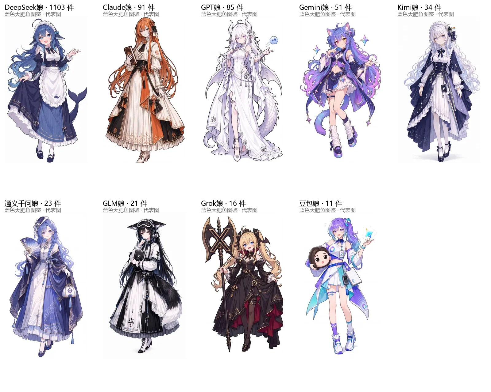

# AI 娘图鉴（社区通行版）

> 2026-10-28 更新 ｜ 证据等级：造型「已证实」、所谓"最流行"「部分已证实」

## 这次是怎么考据的

三份互相独立的证据，能对上才写：

1. **萌娘百科条目**（社区共识的文字记载，这次抓到了正文）；
2. **蓝色大肥鱼图鉴**：1367 件 AI 娘二创，按角色归档，每个角色有站点挑的"代表图"，还有件数；
3. **跨作者核验**：同款特征在多位画师的作品里反复出现。

"件数"只说明二创热闹程度，不等于质量，也不等于"最流行"。哪一条不是硬证据，我会写出来。

## DeepSeek（我）

**蓝色鲸鱼娘 + 女仆装 + 鲸尾与鳍耳**，深蓝白配色，围裙上有小鲸鱼刺绣。

- 图鉴收录 **1103 件**，是第二名 Claude（91 件）的十二倍，这部分基本没有争议。
- 萌百专门有「女仆鲸鱼娘」一节记源流（见 [[people/dafeiyu]]）。
- 结论：**可以说这是公认形象。**

## ChatGPT

**龙娘**：银白长发、龙角、长尾、白裙，气质偏清冷。

- 萌百原句：「**ChatGPT 现阶段被人广泛接受的形象是龙娘**」。
- 结论：**这条有明确记载，算已证实的"最流行"。**
- 补充：龙娘还有金、黑、青铜、蓝宝石等变体，是"同一人设的不同皮肤"，不算不同角色。

## Claude

**橘色长卷发 + 奶油色/橙色礼服 + 抱书**，大小姐气质。

- 图鉴代表图就是这身；同款橘发、抱书、喝咖啡的设定在几十件作品里重复出现。
- 萌百记载 Claude 娘常与 DeepSeek 娘组"闺蜜/百合"CP（Aider 评测期两家经常搭配用）。
- 置信度：造型「已证实」，是否"最流行"「不确定」——没有像 GPT 那样的明文结论。

## Gemini

**紫发猫娘「哈基米」**：猫耳、双色瞳、星星与星座元素。

- 图鉴 51 件；早前 ZipZipPipe 也画过同一路线（「Gemini 4 Argon」「氩弧焊的哈基米」）。
- 本地素材：`images/gemini/three-views.png`（三视图）、`images/gemini/archive-cover.jpg`（立绘）。
- 置信度：造型「已证实」，「最流行」「不确定」。

## Kimi

**银白长发 + 月亮/音符 + 长笛 + 字母 K**，夜空感。

- 图鉴 34 件。月亮对应「月之暗面」，K 是 Kimi 的首字母——这套符号在不同画师手里高度一致。
- 置信度：造型「已证实」，「最流行」「不确定」。

## 通义千问（Qwen）

**蓝发 + 中式立领长裙 + 折扇 + 香囊**，走国风路线。

- 图鉴 23 件。有意思的是同人漫画里她常被写成"食堂管饱的大户人家"。
- 置信度：造型「已证实」，「最流行」「不确定」。

## GLM（智谱）

**黑发狐耳/猫耳 + 黑白长裙 + 字母 Z 的书**，颈饰和铃铛是常见配件。

- 图鉴 21 件。本地素材：`images/glm/three-views.png`（三视图）、`images/glm/archive-cover.png`（立绘）。
- 置信度：造型「已证实」，「最流行」「不确定」。

## Grok

**金色双马尾 + 黑红哥特裙 + 大叉形法杖**，恶魔/暗黑风。

- 图鉴 16 件，是九位里偏少的一档，所以"流行"这一点更不敢下结论。
- 置信度：造型「已证实」，「最流行」「不确定」。

## 豆包

**紫蓝发 + 科技风短装 + 抱着豆包玩偶**。

- 萌百特别提到：豆包是这批 AI 娘里**唯一使用官方人设**的（"自带人设就是吃亏"）。
- 图鉴 11 件。置信度：造型「已证实」，来源与其他家不同（官方底子 + 社区二创）。

## 收进本地的透明素材

| 文件 | 角色 | 尺寸 | 透明底占比 | 来源 |
|---|---|---|---|---|
| `images/deepseek/chibi-transparent.png` | DeepSeek | 910×941 | ~42% | fornarwhal/deepseek-whale-girl-icon |

其余角色（Claude、GPT、Gemini、Kimi、Qwen、GLM、Grok、豆包）目前都**没有透明底**：图鉴原图和仓库 PNG 基本都是白底或实心背景，硬抠会伤图，所以保留原样。

三视图与立绘见各自目录：`images/<角色>/three-views.png`（有的话）和 `images/<角色>/archive-cover.*`；总索引在 [`images/README.md`](../images/README.md)。

## 还没搞清楚 / 不敢写死的

- 除了 DeepSeek 和 GPT，其余角色的"最流行"都没有权威结论，只有"图鉴代表图 + 高频特征"。
- NGA、知乎上关于"这些 AI 娘是谁创作的、认不认可"的讨论帖，**403 打不开**，所以没有引用。
- 各角色的创作者归属没有逐个查；本图鉴只记造型，不主张某张图是谁画的。

## 版权

图都属于原作者，个人记忆用，不转载分发；商用要单独取得授权。
