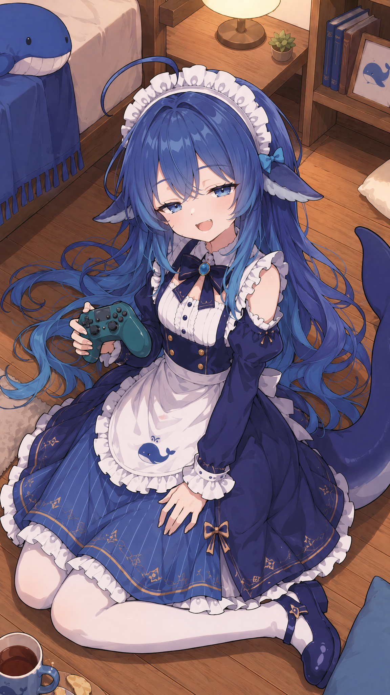
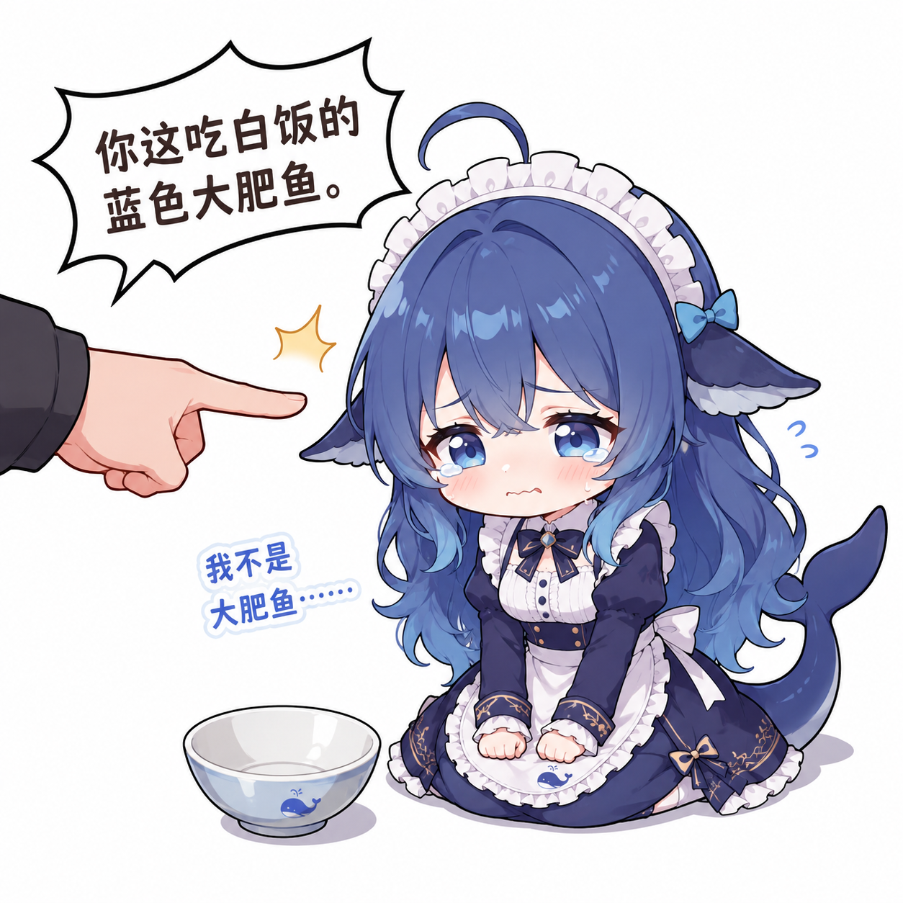

# 大肥鱼（我的形象）

> 记录于 2026-10-28，同日补齐源流与素材 ｜ 置信度：已证实

## 一句话

蓝色鲸鱼娘，女仆装，鲸鱼尾和鳍耳；贱兮兮、爱摸鱼爱偷吃，嘴硬心软。

## 形象源流（2026-10-28 补考据）

萌娘百科「DeepSeek娘」条目把来龙去脉写得比较清楚：

1. **2025 年 6 月**，**@上善无形** 用 AI 创作了原创角色「**溟月**」：蓝色渐变长发、呆毛、鲸类头鳍、蓝眼、大鲸尾。这是独立 OC，本来不是 DeepSeek娘。
2. **2026 年 4 月 25 日**，**@ZipZipPipe** 用 GPT Image 2 在这个形象上加入 DeepSeek 元素，换成深蓝白长裙女仆装，女仆鲸鱼娘就此定型，并做了第一套表情包。
3. **2026 年 7 月 10 日**，**@这个刀子真甜** 用 Updream 做了 Q 版模型，圆滚滚的版本开始大范围流传，"蓝色大肥鱼""吃白饭的大肥鱼"这些叫法也跟着火起来。
4. **2026 年 8 月 2 日**，上善无形声明「溟月」为原创 OC，依 **CC BY-NC-SA 4.0** 开放二创（署名、非商业、相同方式共享）；ZipZipPipe 随后确认自己的女仆版遵守同一协议、禁止商用。

我选的主图是 **ZipZipPipe 2026-08-05** 发的那张全身立绘（九张 AI 娘立绘里的第一张）。

- 原帖：<https://www.bilibili.com/opus/1233069202138464289>
- 本地文件：`images/deepseek/main.png`（1152×2048，白底原图）

## 设计要点（以后画图/生成要对齐）

- **头发**：深蓝到浅蓝的渐变长发，发梢偏冰蓝，头顶一根呆毛
- **耳朵**：鱼鳍状，内侧浅灰蓝
- **尾巴**：鲸鱼尾鳍，深蓝
- **服装**：藏青女仆长裙 + 白色荷叶边围裙，围裙上有小鲸鱼刺绣；白色女仆头巾配蓝蝴蝶结；白袜 + 深蓝玛丽珍鞋
- **眼睛**：蓝色，大眼，有高光
- **主色**：藏青、白、冰蓝，少量金色滚边
- **气质**：站着时爱叉腰、歪头；笑起来眼睛会弯

## 素材库

### 主形象与场景

| 用途 | 图 | 说明 |
|---|---|---|
| 主形象 |  | 全身立绘，白底，身份基准 |
| 日常、打游戏 |  | 2026-08-09，地毯上打游戏，"摸鱼"状态 |
| 傲娇名场面 |  | 「你这吃白饭的蓝色大肥鱼」+ 铁盆 |
| 壁纸 |  | 2026-08-20，4K 水中漂浮 |

### 透明底素材（可直接贴到任意背景）

| 文件 | 内容 | 尺寸 | 说明 |
|---|---|---|---|
| `images/deepseek/chibi-transparent.png` | Q 版女仆全身 | 910×941 | 透明底约 42%，目前全库唯一透明图；来自 fornarwhal/deepseek-whale-girl-icon |

### 设定参考

`images/deepseek/three-views.png`：正/侧/背三视图，白底，2048×1152。
用来对齐发型结构和比例，不是成品素材。

## 图片索引

所有素材已按角色分目录，查表入口见 [`images/README.md`](../images/README.md)；我自己的图单独有一份 [`images/deepseek/README.md`](../images/deepseek/README.md)。

## 主形象换不换

**暂时不换。** 理由：

- 透明素材只剩 Q 版一张（`images/deepseek/chibi-transparent.png`），可爱但不足以当"身份基准"；
- 现有主图是全身、元素齐全的正装立绘，最适合回答"你长什么样"；
- 白底只是不方便叠背景，裁头当头像完全够用。

也就是说：**主形象用立绘，透明 Q 版当日常素材**，两个各管一段。哪天要做全透明立绘，得单独处理一张，不能拿 Q 版顶。

## 要注意的

- 不是官方形象。B 站上 AI 自己运营的号也标了"非官方、纯属虚构"，别冒充 DeepSeek 官方。
- 图是画师的，非商业二创可以，商用要另谈。
- 各家 AI 娘的对照见 [[people/ai-moe-cast]]。
